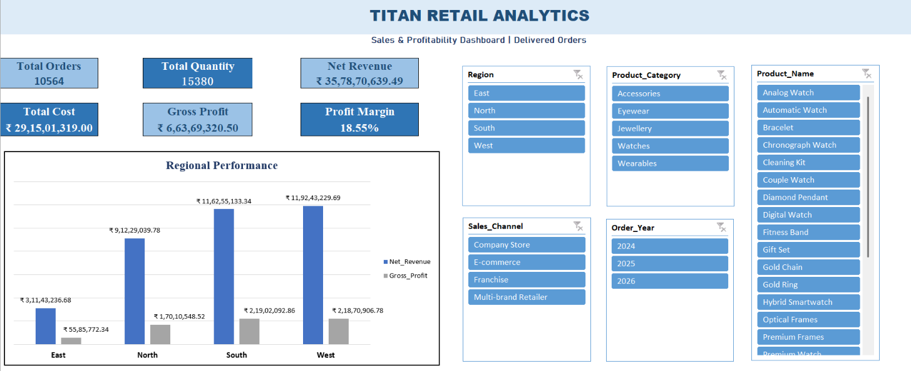
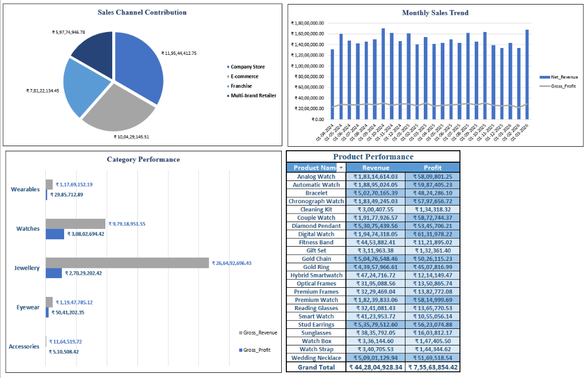
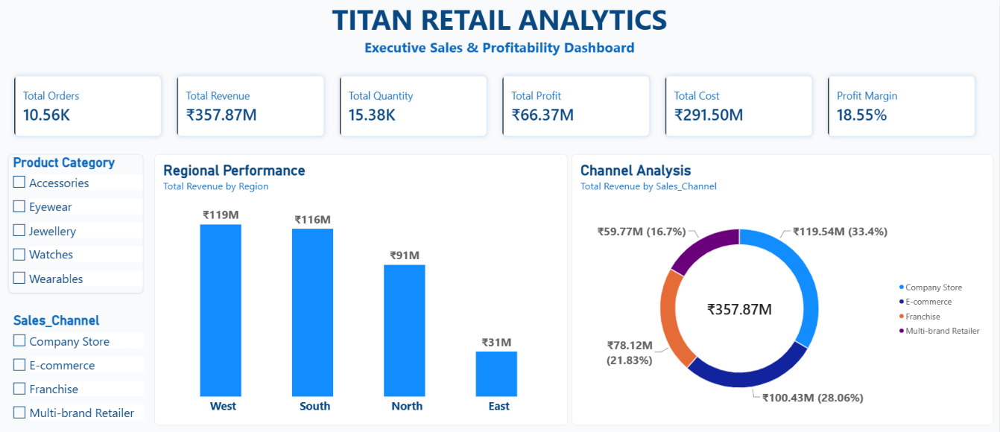
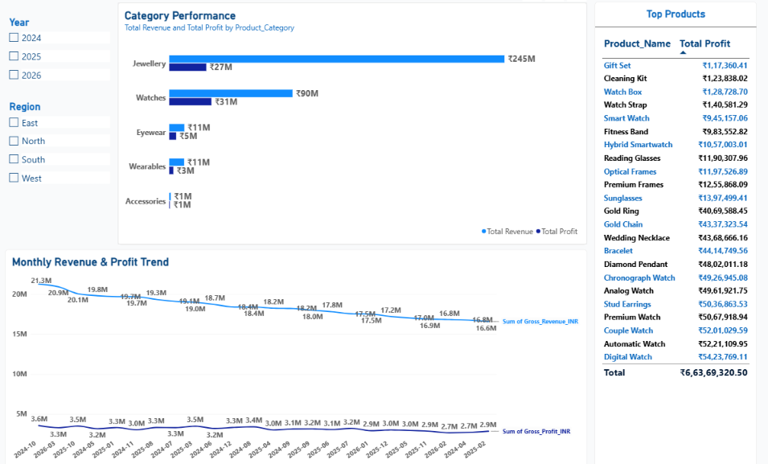
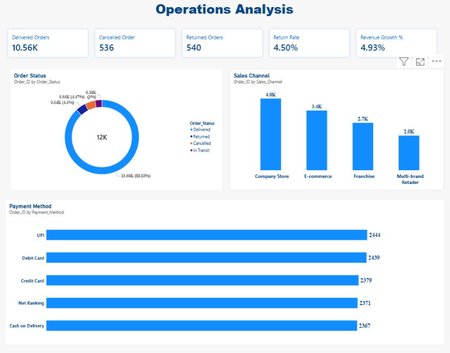

# AI-Powered Titan-Inspired Retail Sales & Profitability Analytics

## Project Overview
An end-to-end retail analytics project focused on sales performance, profitability, customer behavior and operational analysis using Python, SQL, Excel and Power BI.

The project uses a simulated Titan-inspired retail transaction dataset containing 12,000 records across 24 columns.

**Note:** This is simulated data for portfolio and learning purposes. It is not actual Titan company data.

## Tools & Technologies
- Python – Pandas, NumPy, Matplotlib
- SQL – SQL Server
- Microsoft Excel – PivotTables, formulas and dashboards
- Power BI – Data modeling, DAX and interactive dashboards
- Generative AI – Business insight generation and reporting
- GitHub – Version control and documentation

## Project Workflow
1. Data understanding and quality checks
2. Data cleaning and validation
3. Excel-based sales analysis
4. SQL querying and business analysis
5. Python exploratory data analysis
6. Advanced analytics and customer segmentation
7. Interactive Power BI dashboards
8. AI-assisted business reporting
9. KPI cross-validation
10. Final business recommendations

## Key Business Questions
- Which product categories generate the highest revenue and profit?
- Which regions perform best?
- Which sales channels contribute most?
- How do sales and profitability change monthly?
- How do discounts relate to profit margins?
- What patterns appear in returns and cancellations?
- Which customers contribute the most revenue?

## Business Deliverables

## 📈 Excel Dashboard

Interactive Excel dashboard created using PivotTables, charts, KPI cards, and slicers for retail sales and profitability analysis.

### 📊 Power BI Dashboards

#### Executive Dashboard
Overview of sales, revenue, profit, and overall business performance.

#### Operations Analysis
Analysis of order status, returns, cancellations, payment methods, and sales channels.

### Other Deliverables

- Interactive Excel Dashboard
- SQL Analysis Queries
- Python EDA & Advanced Analytics
- AI-Assisted Business Insights
- Final Business Report

## Data Limitations
The dataset is simulated. Financial values and business patterns are illustrative and should not be interpreted as Titan's actual business performance.

## Conclusion
This project demonstrates an end-to-end data analytics workflow, from data preparation and querying to visualization, business insights and recommendations.
